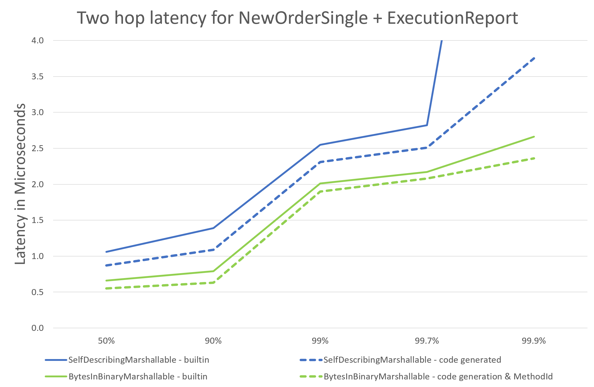
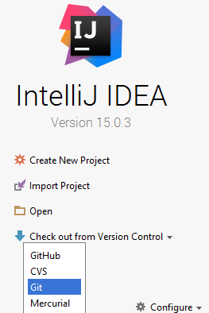
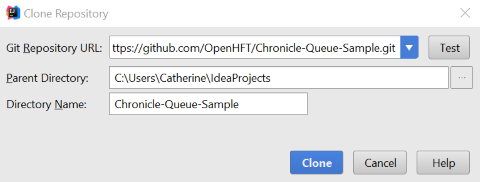
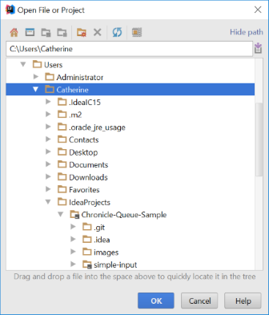

= Chronicle Queue Demo - README
Peter Lawrey
:toc:

This repository demonstrates the usage of Chronicle Queue (and related Chronicle libraries) through multiple examples, including an order processor and hello-world examples. Below is a quick start and pointers to further documentation.

== Quick Start

.Basic Steps
----
git clone https://github.com/OpenHFT/Chronicle-Queue-Demo.git
cd Chronicle-Queue-Demo
mvn clean install
----

To run a simple example, like the hello-world module:

----
cd hello-world
mvn install exec:java@RecordInputToConsoleMain
----

== Documentation

The project’s documentation is consolidated in four AsciiDoc files:

1. xref:architecture.adoc[Architecture]
2. xref:usage-and-tests.adoc[Usage & Tests]
3. xref:reference.adoc[Reference, Style & Glossary]
4. xref:order-processor/README.adoc[Order Processor]

Refer to them for details on architecture, usage instructions, testing approaches, style guides, and advanced references.

The `release/2026.XYZ` line contains `simple-yaml-tester` for YAML scenario tests. The `account` and `event-routing` modules present on `main` are not included in this line.

== Repository Overview

The modules in this repository include:

benchmarks :: Scripts and classes demonstrating throughput/latency benchmarks (e.g., LatencyDistributionMain, ThroughputMain).
hello-world :: A simple introduction to an event-driven microservice using Chronicle Queue (input, exclamation addition, output).
md-pipeline :: A Market Data pipeline example with aggregator, strategy, and an exchange simulator.
message-history-demo :: Demonstrates Chronicle’s `MessageHistory` in bridging or event processing scenarios.
messages-with-text :: An example of writing/reading textual content with minimal garbage creation.
order-processor :: A submodule that acts as a simple OMS (Order Management System), referencing FIX 4.2 concepts.

For deeper details on each, see xref:architecture.adoc[Architecture].

== Order Processor

This is a tutorial demonstrating the usage of Chronicle Queue with simple demo programs.

You can find the source code for the order processor example https://github.com/OpenHFT/Chronicle-Queue-Demo/tree/master/order-processor[here].

== Downloading and Running Sample Programs

On Windows, install a JDK, Apache Maven and Git for Windows. Set `JAVA_HOME` to the JDK directory and add the JDK and Maven `bin` directories to `PATH`. Open a new PowerShell terminal and check:

[source,powershell]
----
java -version
javac -version
mvn -version
git --version
----

Run the Maven commands above directly in PowerShell. Cygwin is not required for the Java build. Shell scripts and native examples may have additional platform requirements.

Open IntelliJ or your favorite https://en.wikipedia.org/wiki/Integrated_development_environment[Integrated Development Environment (IDE)]. If you haven't installed an IDE, we recommend https://www.jetbrains.com/idea/download/#section=windows[IntelliJ], which we'll use for this tutorial.

In IntelliJ, select `Get from VCS` to clone the Chronicle Queue Sample code.

Then, copy the following URL into the `Git Repository URL` field and remember the `Parent Directory`. Click `Clone` to get the code.

[source]
----
https://github.com/OpenHFT/Chronicle-Queue-Demo.git
----

If you close the project, you can reopen it by going to `File -> Open`. You'll find the repository in the directory where you saved it.

Now you're ready to run the example programs! You can start with https://github.com/OpenHFT/Chronicle-Queue-Demo/tree/master/simple-input[Simple Input].

The second example is https://github.com/OpenHFT/Chronicle-Queue-Demo/tree/master/simple-translator[Simple Translator].

== Development baseline

The 2026 migration line uses the migrated YAML tester and the current source BOM.
Build the matching Chronicle source dependencies before `mvn clean verify`.
Java builds require a JDK and Maven; Cygwin is not a Java build prerequisite.
The historical `account` and `event-routing` modules are absent from this line.
Their examples remain on the historical main line; no feature-equivalent
replacement is asserted by the migration. Use the root POM as the module inventory.
